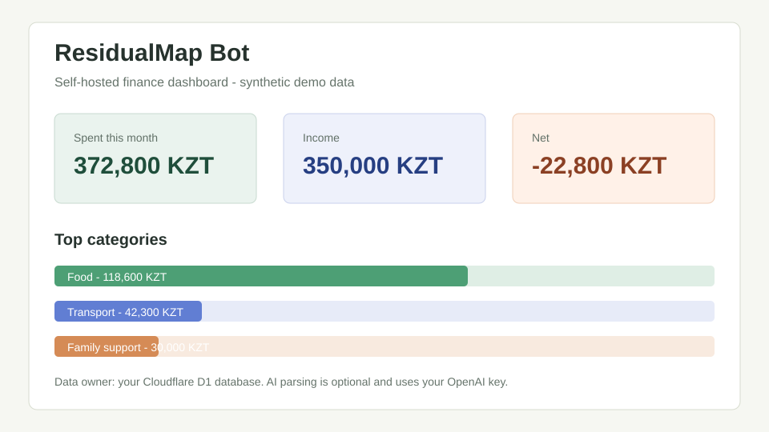
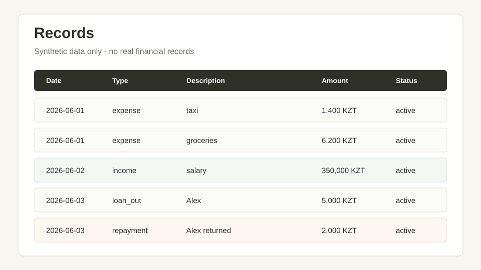
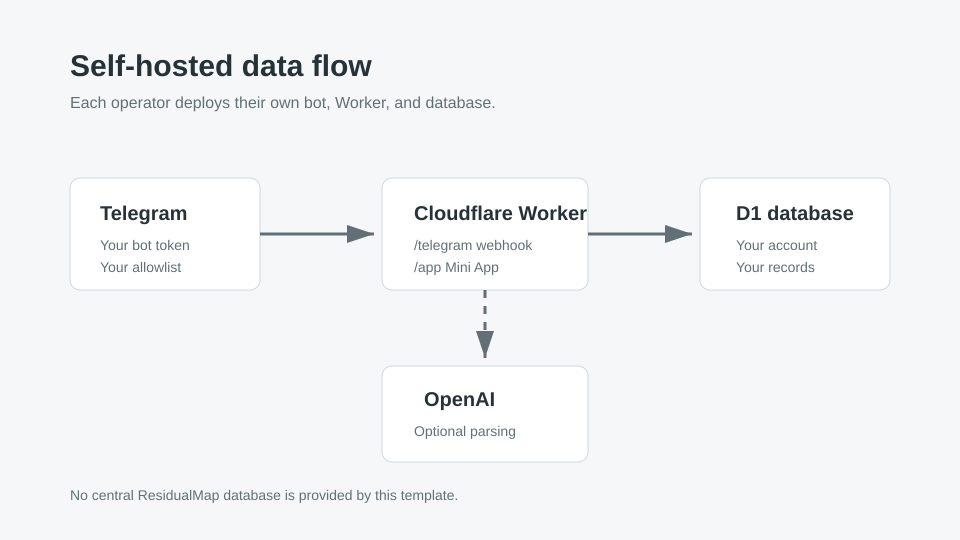

# ResidualMap Bot

ResidualMap Bot is a self-hosted Telegram Mini App and expense-tracking bot for Cloudflare Workers, D1, and OpenAI. It is designed so each user runs their own deployment and keeps their financial database in their own Cloudflare account, instead of trusting a central hosted service with personal transaction data.

This repository is a template for people who want a private finance assistant that they can inspect, modify, and operate themselves.

## Preview

The images below use synthetic data only. They show the intended product shape without exposing any private Telegram account, Cloudflare account, or financial records.







## Why self-hosted

Financial records are sensitive. ResidualMap is intentionally shaped as a self-hosted project:

- You create your own Telegram bot.
- You create your own Cloudflare Worker and D1 database.
- You provide your own OpenAI API key if you want AI parsing and AI summaries.
- The project maintainer does not run a central database for users of this template.

This does not mean data never leaves your infrastructure. Telegram delivers messages to the bot, Cloudflare runs the Worker and D1 database, and OpenAI receives text for classification or summaries when an OpenAI API key is configured. See [PRIVACY.md](PRIVACY.md) for the data flow.

## Features

- Telegram Bot API webhook at `/telegram`.
- Telegram Mini App at `/app`.
- KZT-first expense, income, debt, repayment, transfer, and correction records.
- Cloudflare D1 as the source of truth.
- Soft deletes with audit log entries.
- SQL-based deterministic analytics.
- Optional OpenAI Responses API parsing and analytics summaries.
- CSV export with `/export`.
- Private access through `ALLOWED_TELEGRAM_IDS`.

## Who this is for

ResidualMap is useful if you want a personal or family finance tracker and prefer to run the infrastructure yourself. It is also a compact example of a Cloudflare Workers application that combines Telegram webhooks, D1, a Mini App frontend, and OpenAI Responses API calls.

It is not a hosted SaaS product. The default setup keeps access restricted to Telegram IDs that you explicitly allow.

## Architecture

- Runtime: Cloudflare Workers, entrypoint `src/worker.js`.
- Database: Cloudflare D1, binding `DB`, migrations in `migrations/`.
- Telegram: webhook route `/telegram`; Mini App route `/app`.
- Mini App frontend: `src/mini-app.js`, `src/mini-app-client.js`, and `src/mini-app-styles.js`.
- AI: OpenAI Responses API with `store: false` in API requests.
- Deployment: Wrangler configuration in `wrangler.toml`.

See [docs/ARCHITECTURE.md](docs/ARCHITECTURE.md) for more detail.

## Quickstart

Install dependencies:

```sh
npm install
```

Copy the local environment and Wrangler examples:

```sh
copy .dev.vars.example .dev.vars
copy wrangler.example.toml wrangler.toml
```

Fill `.dev.vars` with local development values. Do not commit `.dev.vars`.

If you are working from a repository that already has a deployment-specific `wrangler.toml`, replace the Worker URL and D1 database ID with values from your own Cloudflare account before deploying.

Create your own Cloudflare D1 database:

```sh
npm run db:create
```

Put the returned `database_id` into your `wrangler.toml`, replacing the placeholder value. Then apply migrations to the remote database:

```sh
npm run db:migrate
```

Run local checks:

```sh
npm run check
```

Run the Worker locally:

```sh
npm run dev
```

Deploy:

```sh
npm run deploy
```

After deployment, set the Telegram webhook:

```sh
curl -X POST -H "Authorization: Bearer $SETUP_TOKEN" https://your-worker.example/admin/set-webhook
```

For the complete deployment guide, see [docs/DEPLOYMENT.md](docs/DEPLOYMENT.md).

For public template publishing checks, see [docs/PUBLISHING_CHECKLIST.md](docs/PUBLISHING_CHECKLIST.md).

For the safe private-to-public transition, see [docs/PUBLICATION_RUNBOOK.md](docs/PUBLICATION_RUNBOOK.md).

For D1 backup and restore guidance, see [docs/BACKUP_RESTORE.md](docs/BACKUP_RESTORE.md).

For release and deployment safety checks, see [docs/RELEASE_CHECKLIST.md](docs/RELEASE_CHECKLIST.md).

For keeping a private production bot while maintaining a public template branch, see [docs/PRIVATE_PRODUCTION.md](docs/PRIVATE_PRODUCTION.md).

For maintainer triage and review guidance, see [docs/MAINTAINER_GUIDE.md](docs/MAINTAINER_GUIDE.md).

For synthetic demo guidance, see [docs/DEMO.md](docs/DEMO.md).

## Required configuration

Non-secret defaults live in `wrangler.toml`:

- `DEFAULT_CURRENCY`
- `DEFAULT_TIMEZONE`
- `OPENAI_MODEL_PARSE`
- `OPENAI_MODEL_ANALYTICS`
- `MINI_APP_URL`

Required secrets:

- `TELEGRAM_BOT_TOKEN`
- `TELEGRAM_WEBHOOK_SECRET`
- `OPENAI_API_KEY`
- `SETUP_TOKEN`
- `ALLOWED_TELEGRAM_IDS`

`ALLOWED_TELEGRAM_IDS` is intentionally not committed to `wrangler.toml` because it contains personal Telegram identifiers. Set it as a Cloudflare secret or in local `.dev.vars`.

## Commands

- `/start` - onboarding.
- `/help` - examples and commands.
- `/id` - show your Telegram user ID.
- `/today` - summary for today.
- `/week` - summary for the current week.
- `/month` - summary for the current month.
- `/debts` - open debts.
- `/last` - show latest active records with IDs.
- `/last deleted` - show latest deleted records.
- `/undo` - soft-delete the latest active record.
- `/delete 123` - soft-delete a record by ID.
- `/restore 123` - restore a deleted record by ID.
- `/export` - download CSV export.
- `/settings` - show current bot settings.
- `/app` - open the Telegram Mini App finance panel.

## Security model

- Telegram webhook requests must include `X-Telegram-Bot-Api-Secret-Token`.
- Admin routes are POST-only and require `Authorization: Bearer <SETUP_TOKEN>`.
- Mini App API routes validate Telegram `initData`.
- User data is filtered by internal `user_id`.
- User-controlled SQL values are passed through prepared D1 statements.
- Telegram HTML output is escaped before interpolation.
- Deletes are soft deletes and are recorded in `audit_log`.

See [SECURITY.md](SECURITY.md) for reporting guidance.

## Local checks

Run:

```sh
npm run check
```

On Windows PowerShell, if script execution blocks `npm`, use:

```sh
npm.cmd run check
```

The check script syntax-checks Worker and Mini App modules and runs the focused Node test suite.

The test suite includes regression coverage for fallback parsing, category canonicalization, Mini App `initData` rejection, allowlist denial, per-user D1 query scoping, Telegram webhook secret rejection, Telegram HTML escaping, route-level CSV export scoping, route-level undo/delete/restore scoping, soft-delete/restore helpers, and CSV cell escaping.

## GitHub workflows

Pull requests and pushes to `main` trigger `.github/workflows/ci.yml`: install dependencies with `npm ci` and run `npm run check`.

Deploys use `.github/workflows/deploy.yml` as a manual workflow: install dependencies, run `npm run check`, and deploy the Worker with `--keep-vars`. D1 migrations are intentionally run manually with `npm run db:migrate`.

Configure these repository secrets before relying on the workflow:

- `CLOUDFLARE_API_TOKEN`
- `CLOUDFLARE_ACCOUNT_ID`

## Roadmap

- Improve the self-hosted setup flow.
- Add public screenshots and a small demo walkthrough using synthetic records.
- Expand route-level tests around Telegram delete/restore commands, CSV export, and D1 backup workflows.
- Add optional rate limits and abuse controls for anyone who decides to run a public shared deployment.
- Add clearer import/export automation and staging restore examples.

See [docs/ROADMAP.md](docs/ROADMAP.md) for the maintainer roadmap and adoption evidence checklist.

## Codex for Open Source fit

This project is being prepared as a public self-hosted OSS template. Codex and API credits would help maintainers review security-sensitive changes, improve test coverage, document deployment paths, and keep the Cloudflare/Telegram/OpenAI integration reliable.

See [docs/CODEX_FOR_OSS.md](docs/CODEX_FOR_OSS.md) for the application pitch and adoption checklist.

See [docs/APPLICATION_PACKET.md](docs/APPLICATION_PACKET.md) for the maintainer-facing application checklist and ready-to-submit form drafts.

## Contributing

Contributions are welcome after the project is public. Start with [CONTRIBUTING.md](CONTRIBUTING.md), follow [CODE_OF_CONDUCT.md](CODE_OF_CONDUCT.md), use [SUPPORT.md](SUPPORT.md) for safe support requests, run `npm run check`, and avoid committing secrets or personal financial data.
